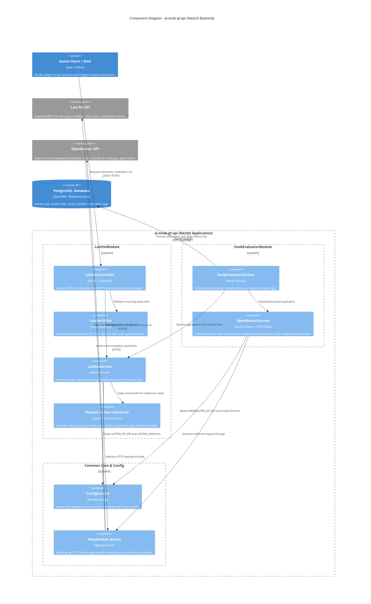

# AI Agent Governance & Architecture Guidelines (**AGENTS**.md)

## Project Overview & Mission

ai-snob-gf-api is a modular NestJS backend designed to evaluate user musical tastes. It consumes listening history from the Last.fm **API**, processes domain models, orchestrates **LLM** prompt pipelines via OpenRouter, and delivers structured critique dialogue back to the client/mod ecosystem.

## System Architecture & Component Boundaries

### 2.1 C4 Component Diagram

## Strict Coding Standards & Conventions

### 3.1 Architecture & Separation of Concerns

Controllers are Thin: Controllers (*.controller.ts) **MUST** **ONLY** handle request mapping, route params, validation pipes, and return **HTTP** responses. No business logic or direct **HTTP** fetching allowed.

Services Encapsulate Domain Logic: All network calls, caching, transformations, and error handling must live in *.service.ts.

Module Isolation: Modules **MUST** export only what other modules need. When injecting LastfmService into SnobEvaluatorModule, LastfmModule must explicitly declare exports: [LastfmService].

No Direct process.env Calls: Always inject and consume ConfigService from @nestjs/config.

### 3.2 TypeScript & Typing Integrity

Strict Typing (Zero any Policy):

The use of any is strictly prohibited.

Use explicit interfaces/types for external raw payloads (e.g., LastfmGetRecentTracksRawResponse).

Map raw payloads to clean domain entities before returning them from services.

Strict Return Types: All public methods in services and controllers must declare their return types explicitly (e.g., Promise<CleanTrack[]>).

### 3.3 **HTTP** & Asynchronous Handling

RxJS & @nestjs/axios: Always wrap this.httpService.get() or this.httpService.post() calls using firstValueFrom from rxjs.

Error Translation:

Catch upstream Axios errors and translate them into native NestJS exceptions (BadGatewayException, InternalServerErrorException, NotFoundException).

Do not leak raw Axios error stacks or sensitive **API** keys in **HTTP** error messages.

### 3.4 Data Validation & DTOs

**DTO** Enforcements: All query parameters, route params, and request bodies must have dedicated **DTO** classes under src/<module>/dto/.

Class Validator & Transformer:

Annotate fields using @IsString(), @IsOptional(), @IsInt(), @Min(), @Max(), etc.

Always apply @Type(() => Number) when receiving query params meant to be parsed as numbers.

## Agent Operational Roles (SDD Workflow)

### 4.1 Planner Agent (z-ai/glm-5.3 / moonshotai/kimi-k3)

Scope: Architectural planning, contract design, schema validation, and task breakdowns.

Permissions: Read-only access to existing code. Write access **ONLY** to .specs/features/<feature-id>/spec.md and plan.md.

Outputs:

spec.md: Detailed input/output contracts, endpoints, query schemas, and edge case specifications.

plan.md: Sequential, atomic checkboxes for code implementation.

### 4.2 Executor Agent (deepseek/deepseek-v4.1-flash-**1017**)

Scope: Implementation of atomic tasks defined in plan.md.

Permissions: Modify files under src/. Run build commands (npm run build).

Constraints:

Execute only one task from plan.md per run.

Do not introduce dependencies without explicit user consent.

Must verify TypeScript compilation passes after every edit.

## Definition of Done (DoD) Checklist

Before any feature or task is marked as complete:

[ ] DTOs are validated with class-validator and class-transformer.

[ ] No any types are introduced in interfaces or method signatures.

[ ] npm run build executes with zero TypeScript compiler errors.

[ ] Target module exports/imports are properly closed in their respective *.module.ts.